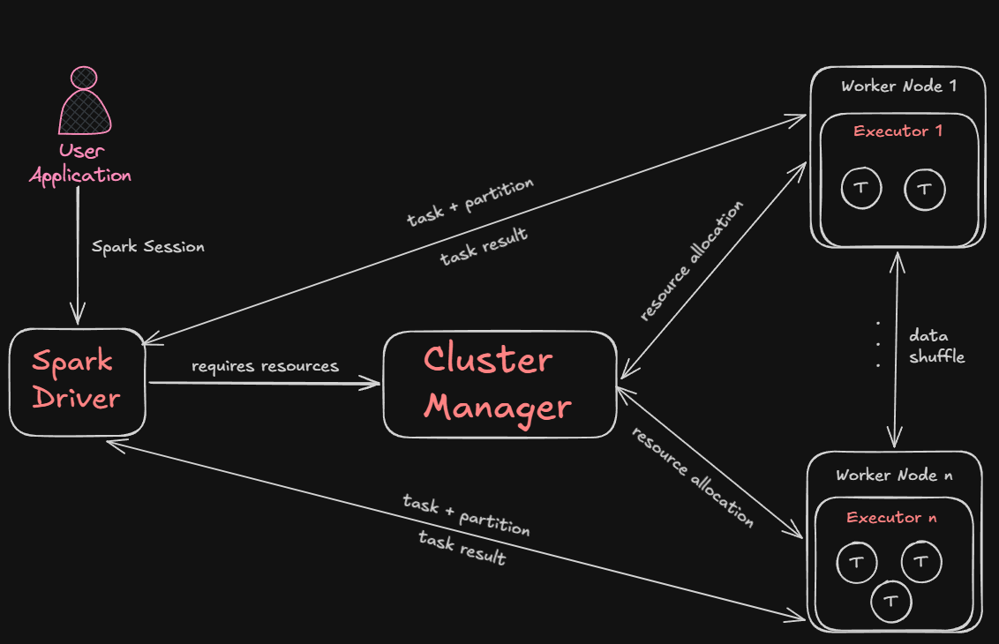
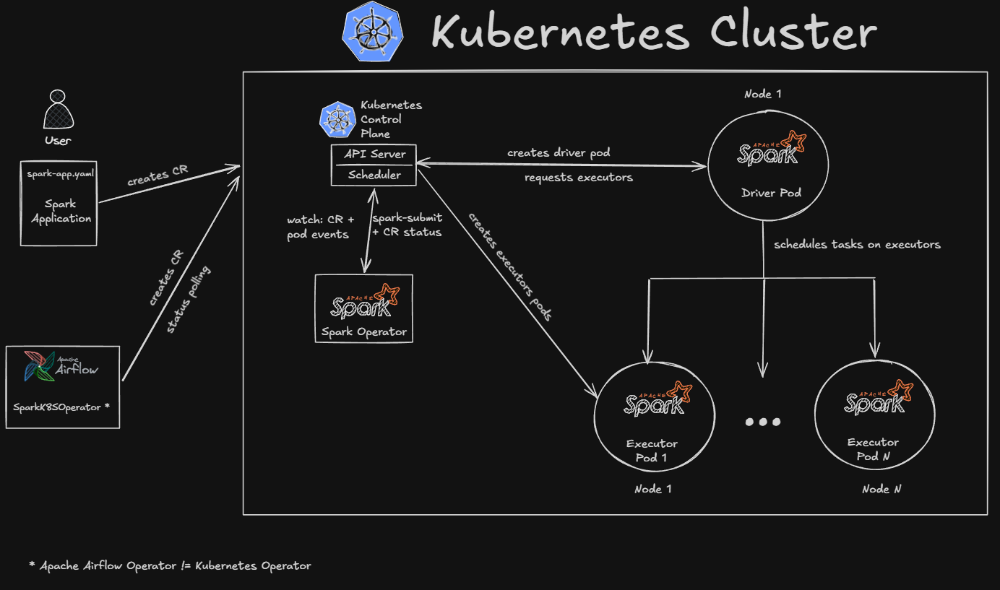

# Arquitetura Spark

* User Application: código PySpark;
* Driver: processo JVM que executa a função main() da aplicação;
	* Pede executors ao Cluster Manager;
	* Divide os dados em tasks;
	* Distribui tasks aos executors.
* Executor: processo JVM que executa tasks;
* Task: unidade de trabalho;
* Worker Node: máquina que executa efetivamente a aplicação;
* Cluster Manager: garante a entrega de executors por meio da alocação de recursos.

# CRD e Operators

## Custom Resource Definition

* Componentes nativos do Kubernetes: Pod, Deployment, Service, Namespace, etc;
* CRD é a forma de criar um novo componente no K8S que não está disponível de forma nativa;
* Sozinho não faz nada, pois apenas registra o novo tipo e o seu esquema;
* Não executa nenhuma lógica;
* É uma extensão da K8S API;
* Precisa de um controlador;
* **Estado declarativo**.

## Operator

* Controlador;
* Reconcilia o estado do K8S cluster de forma a garantir a configuração desejada (loop de reconciliação);
* **Reconciliação contínua**.

# Arquitetura Spark no Kubernetes

* Driver e Executor são Pods;
* Kubernetes é o Cluster Manager.